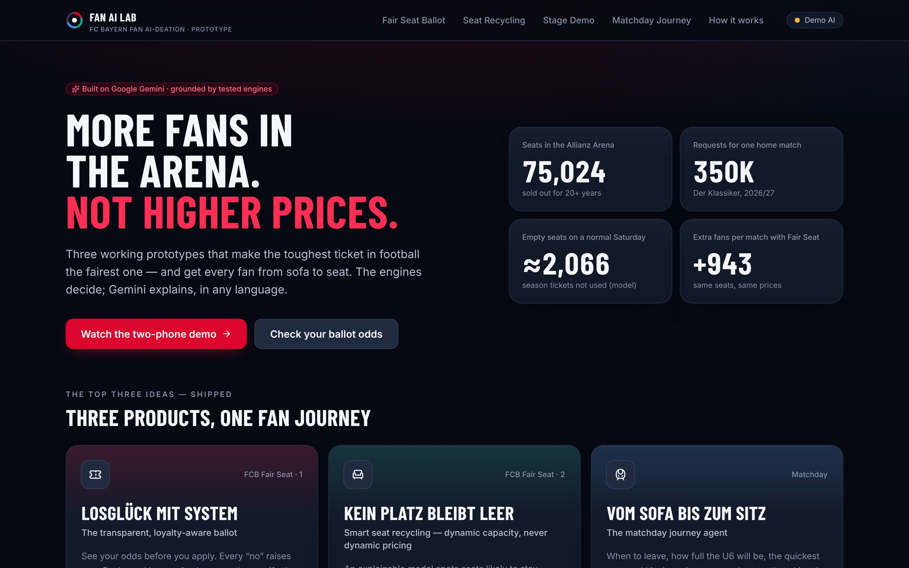
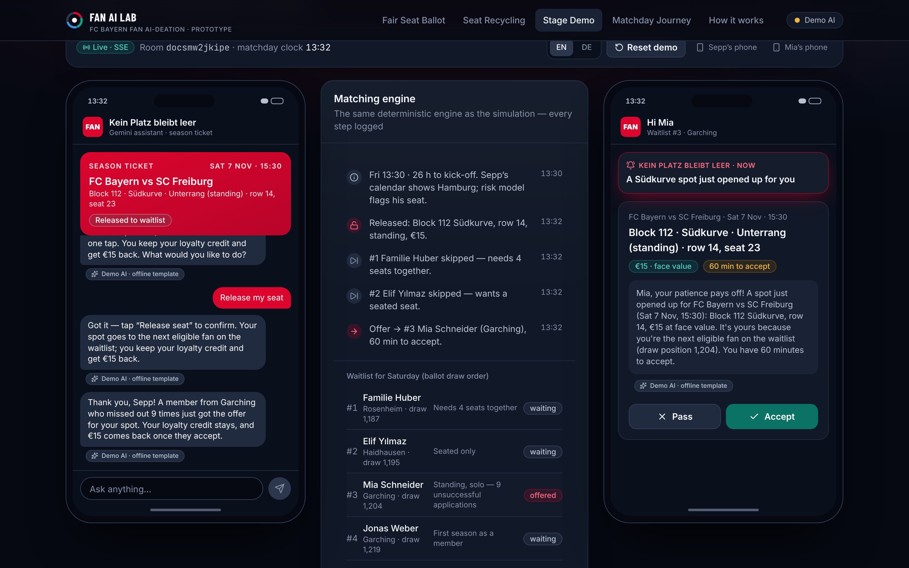
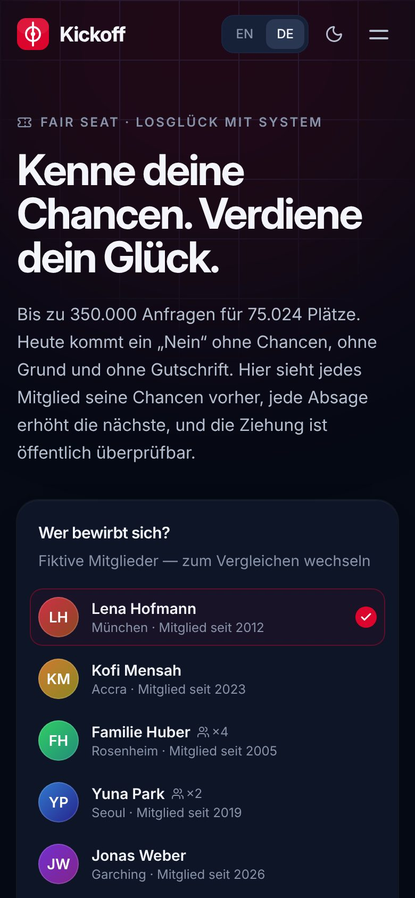
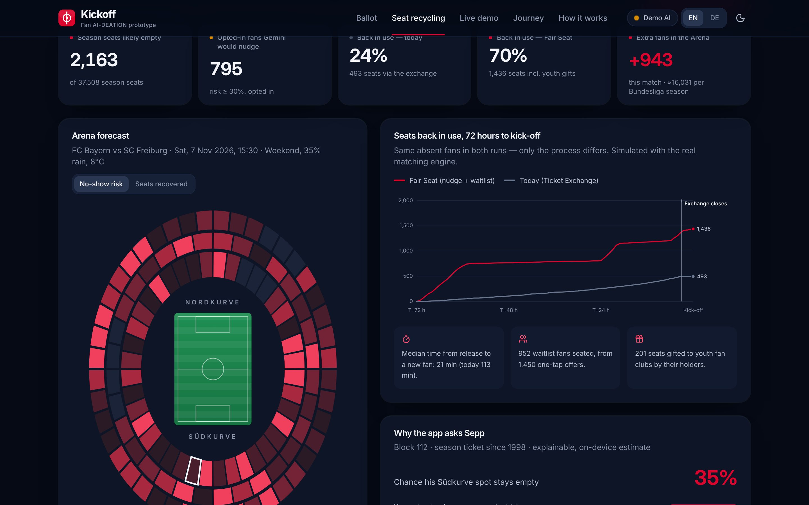
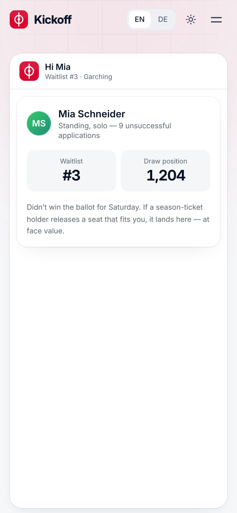
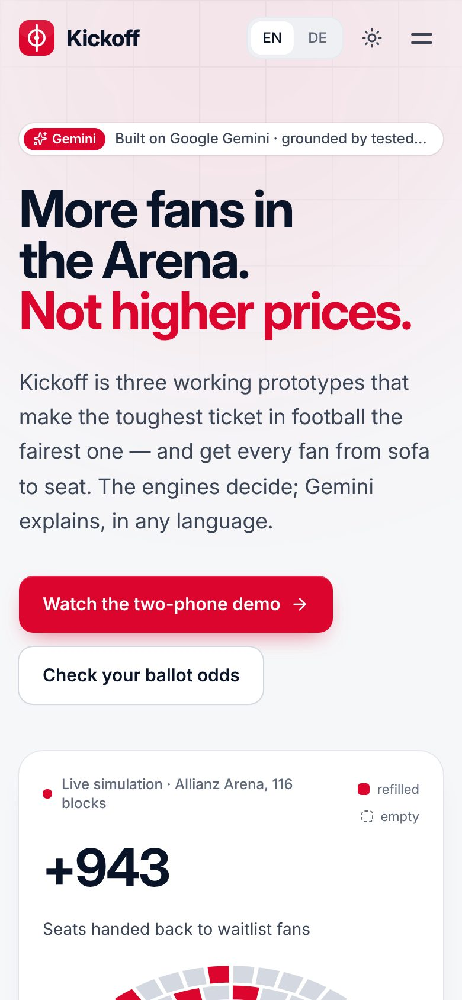
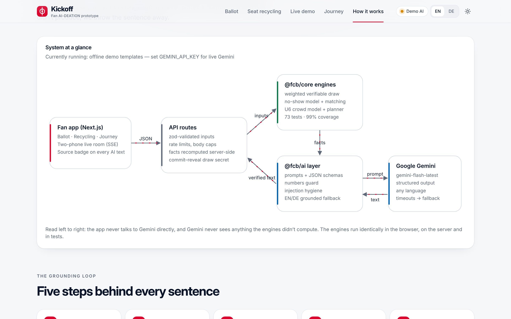
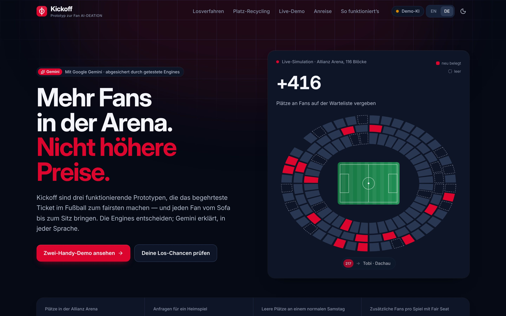

<p align="center">
  <picture>
    <source media="(prefers-color-scheme: dark)" srcset="docs/brand/logo-dark.svg">
    
  </picture>
</p>

<h1 align="center">Kickoff</h1>

<p align="center">
  <a href="https://github.com/azekowka/FCBayernHackathon/actions/workflows/ci.yml"></a>
  <a href="https://github.com/azekowka/FCBayernHackathon/commits"></a>
  
  <br>
  
  
  
  
  <br>
  
  
  
  
</p>

<p align="center">
  <b>More fans in the Arena. Not higher prices.</b><br>
  Three Gemini-powered prototypes for the FC Bayern Fan AI-DEATION — a fair ballot, smart seat recycling and a matchday journey agent.
</p>

<p align="center">
  <br>
  <sub>The hub: the real 116-block Allianz Arena refills itself as released seats go to waitlist fans.</sub>
</p>

<p align="center">
  <br>
  <sub>The stage demo: Sepp releases his Südkurve spot in a Gemini chat, Mia gets the offer seconds later.</sub>
</p>

**Kickoff** makes the toughest ticket in football the fairest one — and gets every fan from sofa to seat. Up to
**350,000 requests chase 75,024 seats**, on a normal Saturday **~2,100 season seats stay empty**, and most of the
crowd squeezes through one U-Bahn line. Kickoff answers all three with working software.

**Engines decide. Gemini explains.** Every odds figure, draw position, seat and queue minute comes from
deterministic, unit-tested TypeScript engines. Gemini only turns those facts into conversation — in English or
Deutsch — and a numbers guard throws away any sentence with a figure the engines didn’t produce.

Contents: [Feature tour](#feature-tour) · [How it works](#how-it-works) · [Design](#design) ·
[Run locally](#run-locally) · [Configuration](#configuration) · [Tests](#tests) · [Deploy](#deploy) ·
[Repo layout](#repo-layout) · [Honest limits](#honest-limits)

> Independent hackathon prototype. Not an official FC Bayern product. All members, tickets, demand and travel
> figures are synthetic and illustrative.

## Feature tour

### 1. Losglück mit System — the fair ballot

<table>
  <tr>
    <td align="center"><br><sub>Commit → draw → verify on the full 350k-request scale.</sub></td>
    <td align="center"><br><sub>On a phone, in Deutsch, dark theme.</sub></td>
  </tr>
</table>

| What the member does      | What happens                                                                                                    |
| ------------------------- | --------------------------------------------------------------------------------------------------------------- |
| Picks up to three matches | Odds appear _before_ applying — loyalty takes a long-suffering member’s Klassiker odds from 1 in 42 to 1 in 15. |
| Taps **Use smart picks**  | Same three applications, chance of at least one match rises from **21% → 35%**.                                 |
| Runs the draw             | A SHA-256 commitment is published first, the seed is revealed after, and the entry re-verifies in the browser.  |
| Doesn’t win               | The Pechvogel bonus grows, and the draw order becomes the recycling waitlist.                                   |

### 2. Kein Platz bleibt leer — smart seat recycling

<table>
  <tr>
    <td align="center"><br><sub>Explainable no-show forecast per block, simulated against today’s exchange.</sub></td>
    <td align="center"><br><sub>The waitlist fan’s phone — full screen on a real device.</sub></td>
  </tr>
</table>

Dynamic capacity, **never dynamic pricing**. The model spots likely-empty seats, Gemini asks the holder kindly,
and one tap hands the seat to the next fan who fits, right up to kick-off. Today’s exchange brings back **~24%** of
empty seats; Fair Seat brings back **~70%** — **+940 fans per match** at the same prices.

### 3. Vom Sofa bis zum Sitz — the matchday journey agent

<table>
  <tr>
    <td align="center"><br><sub>Free text in, plan out — re-planned live for a strike.</sub></td>
    <td align="center"><br><sub>Built phone-first.</sub></td>
  </tr>
</table>

When to leave, how full the U6 will be, the quickest gate and kiosk, and a staggered return. Leaving with the
crowd means a **~23 min** U6 queue; staying 30 minutes for the post-match show means **~4 min**.

## How it works

```
Fan app (Next.js · EN/DE · light/dark)
   │  typed JSON
   ▼
API routes ── zod validation · rate limits · facts recomputed server-side
   │
   ├──► @fcb/core   deterministic engines ──► facts
   │                (weighted draw · no-show model + matching · U6 crowd model + planner)
   │
   └──► @fcb/ai     Gemini adapter ──► text ──► numbers guard ──► fan
                    (falls back to grounded EN/DE templates on any failure)
```

- **Numbers are code.** Odds, seats and minutes come from `@fcb/core`, which runs identically in the browser,
  on the server and in tests. There is no `Math.random` in domain code — every random choice flows from a seed.
- **Draws are verifiable.** An Efraimidis–Spirakis exponential race with `seed = HMAC(DRAW_SECRET, drawId)`,
  committed before the draw and revealed after. Any member can recompute their own race time.
- **Gemini is guarded.** It writes only from the facts. An invented number, a timeout or invalid JSON switches
  to a grounded template, and every AI text carries a source badge (Gemini · Demo AI · safe fallback).
- **The fan decides.** Gemini can suggest releasing a seat; only the fan’s tap executes it.
- **One language per answer.** Facts are localised before they reach Gemini, so German replies never mix in
  English engine text.

<p align="center">
  <br>
  <sub>The in-app architecture page, with data flowing along each arrow.</sub>
</p>

## Design

Bayern red `#DC052D` leads, Bayern blue `#0066B2` supports, white carries the light theme and deep navy the dark
one. The interface is design-engineered with [Emil Kowalski’s skills](https://github.com/emilkowalski/skills)
(installed in `.claude/skills`); the rules and their reasons live in [`DESIGN.md`](DESIGN.md).

<p align="center">
  <br>
  <sub>Deutsch and the dark theme — switch both in the header.</sub>
</p>

| Area     | What you get                                                                                                                                                                |
| -------- | --------------------------------------------------------------------------------------------------------------------------------------------------------------------------- |
| Themes   | Semantic colour tokens render light and dark from one set of utilities, with no flash on load (`next-themes`).                                                              |
| Language | Typed EN/DE dictionaries, cookie + `Accept-Language` detection, localised numbers, dates and engine output.                                                                 |
| Motion   | Custom ease-out curves, press feedback, rolling numbers (NumberFlow), clip-path segmented controls, charts that draw once, spring tickets. Reduced motion keeps fades only. |
| Mobile   | No tap flash, 16 px inputs, safe-area insets, per-scheme `theme-color`, full-screen phone views on real devices.                                                            |
| Access   | axe WCAG 2 A/AA clean on every page, real radio groups and switches, visible focus, text alternatives for every chart.                                                      |

## Run locally

Requires Node 22.12+ and pnpm 10 (`corepack enable`).

```bash
pnpm install
cp .env.example apps/web/.env.local
pnpm dev                      # http://localhost:3000
```

It works fully offline out of the box: without a Gemini key every AI text comes from deterministic, grounded
templates and the header shows **Demo AI**. For the stage demo on two real phones, run one server instance
(live rooms are in memory), open `/live/sepp?room=stage` and `/live/mia?room=stage` on two devices, and use
`/live?room=stage` as the presenter view. Updates arrive over Server-Sent Events, with a polling fallback.

## Configuration

| Capability              | Needs                                                                        |
| ----------------------- | ---------------------------------------------------------------------------- |
| Live Gemini text        | `GEMINI_API_KEY` (model `gemini-flash-latest`, override with `GEMINI_MODEL`) |
| Force offline templates | `AI_MODE=demo` — for flaky venue Wi-Fi                                       |
| Production ballot seeds | `DRAW_SECRET` — a long random value                                          |

Nothing else is required. Without a key the app behaves the same, with templates instead of Gemini prose.

## Tests

```bash
pnpm verify                   # prettier · eslint · typecheck · unit tests · production build
pnpm e2e                      # Playwright, desktop + Pixel 7, axe WCAG 2 A/AA
```

| Suite                         | Covers                                                                                                                                                                                                |
| ----------------------------- | ----------------------------------------------------------------------------------------------------------------------------------------------------------------------------------------------------- |
| `packages/core` — 73 tests    | SHA-256 vs NIST, odds calibrated against seeded draws, property tests (seats never exceeded, groups never split), deterministic replay, the journey always seats the fan on time. ~99% line coverage. |
| `packages/ai` — 36 tests      | Fake Gemini SDK, timeouts, invalid JSON, numbers guard, injection hygiene, EN/DE intents, every template passes its own grounding check.                                                              |
| `apps/web` — 13 tests         | Rate limiting, body caps, error mapping, stateless commit–reveal, live-room choreography.                                                                                                             |
| `apps/web/e2e` — 44 scenarios | Every page: no console errors, axe clean, no overflow at device width; ballot, recycling, three-device live demo, journey, EN→DE switch, theme toggle.                                                |

CI runs all of it on every push (`.github/workflows/ci.yml`).

## Deploy

```bash
docker build -t kickoff . && docker run -p 8080:8080 kickoff
```

Any Node host works too (`pnpm build && pnpm start`). On **Google Cloud Run**, use `--max-instances=1` for stage
demos, because live rooms are held in memory.

## Repo layout

| Path                      | What lives there                                                              |
| ------------------------- | ----------------------------------------------------------------------------- |
| `packages/core`           | Deterministic engines: ticketing, seats, journey, shared PRNG and SHA-256     |
| `packages/ai`             | Gemini client, guards, numbers guard, skills (letter · seat chat · journey)   |
| `apps/web/src/app`        | Pages and API routes (ballot, draw, live rooms over SSE, AI)                  |
| `apps/web/src/components` | Design system and product UI (ballot, recycling, live, journey, charts)       |
| `apps/web/src/lib/i18n`   | EN/DE dictionaries, locale detection, localisation of engine facts            |
| `apps/web/e2e`            | Playwright user scenarios with axe                                            |
| `docs`                    | Pitch script, submission answers, brand and screenshots                       |
| `.claude/skills`          | Emil Kowalski’s design-engineering skills used to build the UI                |
| `DESIGN.md`               | Colour, type, motion, feedback, mobile and language rules, with their reasons |

## Honest limits

- All members, tickets, demand and travel figures are synthetic; the models are tuned to be plausible, not fitted
  to FC Bayern data.
- The transit network is schematic; production would swap in Google Maps Routes and MVG live data through the
  same interfaces.
- Live rooms live in one process’s memory, so run a single instance for the stage demo.
- Offline templates cover English and German; other languages need a Gemini key.
- There is no real ticketing, payment or identity integration — the ballot and wallet tickets are demonstrations.

<p align="center"><sub>Built for the FC Bayern Fan AI-DEATION with Google Gemini and UnternehmerTUM. An independent prototype, not an official FC Bayern product. MIT © 2026 Abdulaziz Gabitov.</sub></p>
