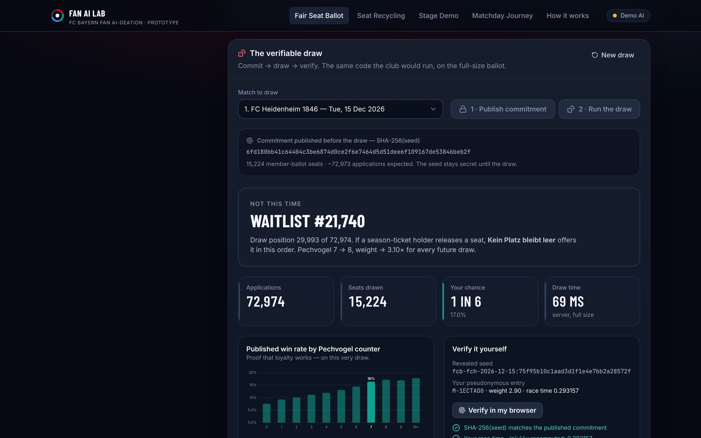
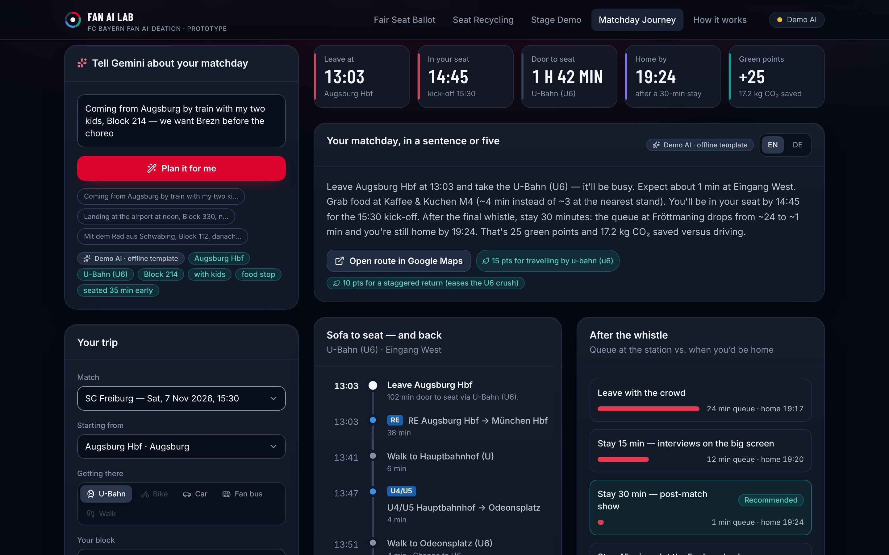

# Fan AI Lab — FCB Fair Seat + Matchday Journey Agent

**Three working, Gemini-powered prototypes for the [FC Bayern Fan AI-DEATION](https://fcbayern.com/en/fans/ai-deation)**
— the top three ideas from our research, shipped as one product family:

|     | Product                                        | What it does                                                                                                                                                                                                                                 |
| --- | ---------------------------------------------- | -------------------------------------------------------------------------------------------------------------------------------------------------------------------------------------------------------------------------------------------- |
| 🎟️  | **Losglück mit System** (FCB Fair Seat · 1)    | Transparent, loyalty-aware ballot: odds before you apply, a _Pechvogel_ bonus that grows with every “no”, “apply smart” recommendations, and a **verifiable commit–reveal draw** on the full 350,000-request scale.                          |
| 💺  | **Kein Platz bleibt leer** (FCB Fair Seat · 2) | Smart seat recycling — _dynamic capacity, never dynamic pricing_. An explainable model spots likely-empty seats, Gemini nudges the holder kindly, one tap hands the seat to the next fan in the ballot’s own waitlist, right up to kick-off. |
| 🚇  | **Vom Sofa bis zum Sitz**                      | Matchday journey agent: when to leave, how full the U6 will be, the quickest gate and kiosk, a staggered return that skips the Fröttmaning crush — and live re-planning for strikes, closures and rain.                                      |

> Independent hackathon prototype. Not an official FC Bayern product. All members, tickets, demand and travel figures are **synthetic and illustrative**.


## Why it matters (the numbers on screen are computed live by the engines)

- **75,024 seats, up to 350,000 requests** per home match — loyalty almost triples a long-suffering member’s Klassiker odds (1 in 42 → 1 in 15), and _apply smart_ lifts the chance of at least one match from **21% → 35%** with the same three applications.
- On a normal Saturday ~**2,100 season seats** go unused. Today’s exchange brings back **~24%**; Fair Seat brings back **~70%** — **+940 fans per match, ≈16,000 per Bundesliga season**, same prices.
- Leaving with the crowd means a **~23 min** U6 queue; staying 30 minutes for the post-match show means **~4 min** — home only ~10 minutes later.

## Engines decide. Gemini explains.

```
Fan app (Next.js) ──► API routes (zod, rate limits, server-side facts)
                         │
                         ├──► @fcb/core   deterministic engines  ──► facts
                         │                 (draw, no-show model, matching, crowd model, planner)
                         │
                         └──► @fcb/ai     Gemini adapter ──► text ──► numbers guard ──► fan
                                          (falls back to grounded templates on any failure)
```

1. **Compute** — every odds figure, draw position, seat, queue minute comes from `@fcb/core` (pure TypeScript, runs identically in browser, server and tests).
2. **Phrase** — Gemini turns those facts into conversation, in the fan’s language (`@google/genai`, structured JSON output for intents).
3. **Verify** — a _numbers guard_ rejects any reply containing a number the engine didn’t produce.
4. **Fall back** — timeouts, invalid JSON or invented numbers switch to deterministic EN/DE templates.
5. **Disclose** — every AI text carries a badge: _Gemini_, _Demo AI_ or _safe fallback_.

Gemini can **suggest** releasing a seat; only the fan’s **tap** executes it. Ballot seeds are committed (SHA-256) before the draw and revealed after; any member can re-verify their own entry in the browser.

| Ballot (commit → draw → verify → letter)       | Seat recycling control room                     |
| ---------------------------------------------- | ----------------------------------------------- |
|  |  |
| **Two-phone stage demo**                       | **Matchday journey agent**                      |
|     |      |

## Quick start

Requirements: Node ≥ 22.12, pnpm 10 (`corepack enable`).

```bash
pnpm install
pnpm dev                      # http://localhost:3000 — works fully offline (Demo AI)
```

Live Gemini (optional): copy `.env.example` to `apps/web/.env.local` and set `GEMINI_API_KEY`
(default model `gemini-flash-latest`, override with `GEMINI_MODEL`). `AI_MODE=demo` forces offline mode for flaky venue Wi-Fi.

### Stage demo on two real phones

Run one server instance (live rooms are in memory), then open on two devices:

- Sepp (season-ticket holder): `http://<host>:3000/live/sepp?room=stage`
- Mia (waitlist fan): `http://<host>:3000/live/mia?room=stage`
- Presenter view with the engine log: `http://<host>:3000/live?room=stage`

Updates are pushed over Server-Sent Events, with automatic polling fallback.

## Quality

```bash
pnpm verify                   # prettier · eslint · typecheck · unit tests · production build
pnpm e2e                      # Playwright user scenarios, desktop + Pixel 7, axe WCAG 2 A/AA
```

| Suite                                          | What it covers                                                                                                                                                                                                                                                                                       |
| ---------------------------------------------- | ---------------------------------------------------------------------------------------------------------------------------------------------------------------------------------------------------------------------------------------------------------------------------------------------------- |
| `packages/core` — 73 tests, ~99% line coverage | SHA-256 vs NIST/`node:crypto`, odds estimator calibrated against thousands of seeded draws, property tests (seats never exceeded, groups never split, outcome independent of list order, engine invariants + deterministic replay), no-show model monotonicity, journey always seats the fan on time |
| `packages/ai` — 32 tests                       | Fake Gemini SDK, timeouts, invalid JSON / schema failures, numbers guard, injection hygiene, EN/DE intents, every template passes its own grounding check                                                                                                                                            |
| `apps/web` — 12 API tests                      | Rate limiting, body caps, error mapping, stateless commit–reveal, live-room choreography, route validation                                                                                                                                                                                           |
| `apps/web/e2e` — 40 scenarios                  | Every page: no console errors, axe (no serious/critical), no horizontal overflow; ballot, recycling, three-device live release/pass/accept, journey free text → strike re-plan → Q&A                                                                                                                 |

CI runs all of it on every push (`.github/workflows/ci.yml`).

## Project structure

```
packages/core     domain engines (ticketing · seats · journey · shared PRNG/SHA-256)
packages/ai       Gemini client, config, guards, numbers guard, skills (letter · seat chat · journey)
apps/web          Next.js 16 app: pages, API routes, live rooms (SSE), design system, e2e tests
docs/             pitch script, submission answers, screenshots
```

Key design decisions:

- **Deterministic core, isomorphic.** No `Math.random` in domain code (lint-enforced); every random choice flows from a seed.
- **Verifiable draw.** Efraimidis–Spirakis exponential race (`key = −ln(u)/w`, `u = H(seed, entryId)`): order-independent, auditable, and the losers’ order _is_ the recycling waitlist.
- **Event-sourced recycling engine.** Same rules in the live room, the in-browser demo and the Monte-Carlo simulation; replaying the event log reproduces the state exactly.
- **Stateless commit–reveal.** `seed = HMAC(DRAW_SECRET, drawId)` — no database needed, works across instances.
- **Server recomputes facts.** The client never sends numbers that end up in a prompt.

## Deploy

- **Vercel / any Node host:** `pnpm build && pnpm start` (set `GEMINI_API_KEY`, `DRAW_SECRET`).
- **Google Cloud Run:** `docker build -t fan-ai-lab . && docker run -p 8080:8080 fan-ai-lab` — use `--max-instances=1` for stage demos (in-memory live rooms).

## Pitch kit

- [`docs/PITCH.md`](docs/PITCH.md) — 5-minute pitch script and demo run-sheet
- [`docs/SUBMISSION.md`](docs/SUBMISSION.md) — ready-to-paste answers for the AI-DEATION form

## License

MIT © 2026 Abdulaziz Gabitov
